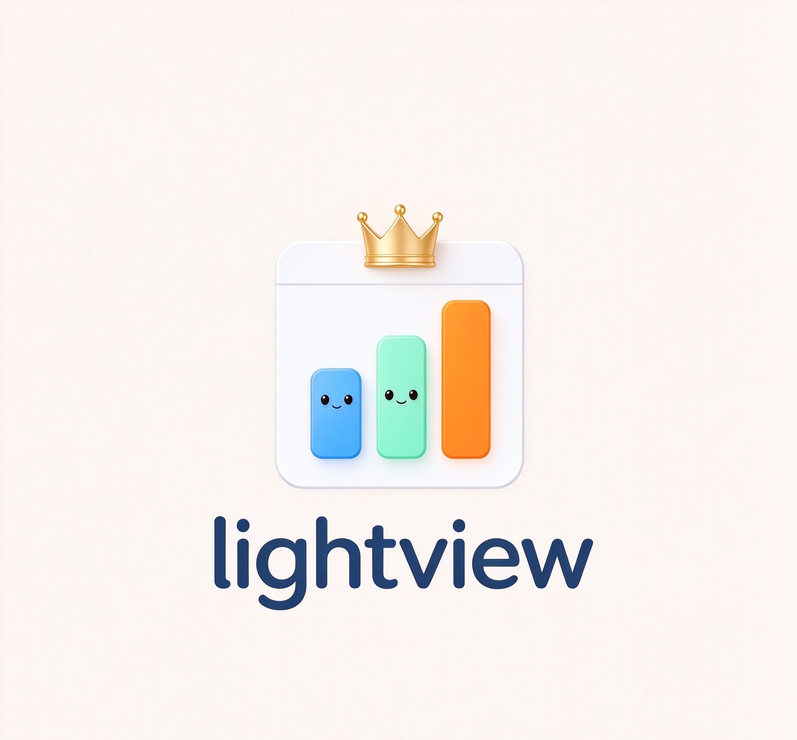

# LightView

> Lightweight BI dashboards for small teams (3–10 people).

LightView turns everyday business data into clear, shareable dashboards — no SQL, no data team, no enterprise contract required.

## Why

Small teams need answers from their data, but the current options don't fit:

- Enterprise BI tools (Plecto, Databox) start at $200+/month or require 10+ seats
- Database-first tools (NocoDB) assume you have a technical person on staff
- Free options (Looker Studio) need constant manual setup and maintenance

LightView sits in the gap: connect your data sources once, pick a ready-made dashboard template, and get answers — for a flat monthly price a small team can actually afford.

## What it does

- 🔌 **Connect** — CSV / Google Sheets / databases / APIs
- 📊 **See** — curated dashboard templates for e-commerce, operations, and marketing metrics
- 💰 **One flat price** — everything included, no per-seat pricing games

## Status

🚧 **MVP in development** (started Nov 2026).

Roadmap:

- [ ] Data source connectors (CSV, Google Sheets)
- [ ] Dashboard templates (e-commerce / ops starter set)
- [ ] Subscription billing & customer portal
- [ ] Public beta

## Tech stack

Next.js · Supabase · Vercel

## About

Built solo, in public. Questions or feedback? [Open an issue](https://github.com/jj377/lightview/issues).
